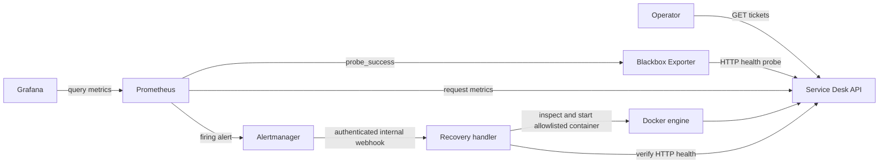

# CloudGuard

**Availability monitoring and automated recovery for a Service Desk API.**

CloudGuard runs a small IT operations API alongside independent HTTP probes, Prometheus, Alertmanager, and Grafana. When a controlled container stop makes the API unavailable, an internal recovery handler starts the allowlisted workload and verifies its HTTP health.

**Project status:** Validated locally on Docker Desktop with Linux ARM64 containers. AWS EC2 deployment is **proposed**.

[Quick start](#quick-start) · [Architecture](#architecture) · [Local results](#local-results) · [Documentation](#documentation)

## What it demonstrates

- A read-only ticket API with status, priority, and result-limit filters, backed by clearly labeled synthetic data.
- Independent availability probes alongside application latency and request-rate metrics.
- Authenticated, allowlisted recovery with container identity checks, duplicate handling, and overlap prevention.
- A provisioned Grafana dashboard and repeatable scripts for load tests and recovery trials.

The use case is a small IT Service Desk that needs visibility into open incidents and a way to restore an unavailable ticket API. The records represent fictional operational scenarios; every response identifies its data source as `synthetic-demo`.

## Quick start

You need a running Docker Desktop installation with Compose v2+, Python 3.9+ for the operator scripts, and free disk space for images and volumes. Linux ARM64 is the validated container platform; other platforms remain unverified.

```bash
git clone https://github.com/itdanndev-eng/cloudguard.git
cd cloudguard
python3 scripts/bootstrap.py
docker compose config --quiet
docker compose up -d --build
docker compose ps
```

Check the API:

```bash
curl http://127.0.0.1:18000/health
curl 'http://127.0.0.1:18000/api/tickets?status=open&priority=P1&limit=20'
```

Bootstrap generates local credentials under ignored `secrets/` and retains them on subsequent runs. Grafana uses the username `cloudguard`; read `secrets/grafana_password` locally for its generated password. Keep credential files out of commits and screenshots.

### Local interfaces

| Interface | URL |
|---|---|
| Service Desk API | http://127.0.0.1:18000/api/tickets?status=open&limit=20 |
| Health check | http://127.0.0.1:18000/health |
| Prometheus targets | http://127.0.0.1:19090/targets |
| Prometheus alerts | http://127.0.0.1:19090/alerts |
| Alertmanager | http://127.0.0.1:19093 |
| Grafana dashboard | http://127.0.0.1:13000/d/cloudguard-service-desk |

All published interfaces bind to `127.0.0.1`. Optional port settings are in [.env.example](.env.example); the measurement scripts currently expect the default ports above.

### API endpoints

| Method | Path | Purpose |
|---|---|---|
| GET | `/health` | Application status, service identity, and synthetic-data label |
| GET | `/api/tickets` | Filtered synthetic ticket queue |
| GET | `/metrics` | Prometheus request counters and latency histograms |

Ticket filters accept `status=open|in_progress|resolved`, `priority=P1|P2|P3`, and an integer `limit` from 1 to 100. The default limit is 20. Invalid filters return HTTP 400.

## Architecture



| Service | Role |
|---|---|
| Service Desk API | Serves synthetic tickets and exports request metrics |
| Blackbox Exporter | Probes HTTP health independently of the workload |
| Prometheus | Collects metrics and evaluates alert rules |
| Alertmanager | Routes the intended outage alert to recovery |
| Recovery handler | Verifies container identity, starts the stopped workload, and checks HTTP health |
| Grafana | Displays availability, latency, and request rate |

### Detection and recovery

1. Prometheus scrapes and evaluates rules every **5 seconds**. Application availability is measured by `probe_success{job="servicedesk-http"}`; `up` for that job measures the probe exporter's reachability.
2. After a failed HTTP probe persists for **10 seconds**, `ServiceDeskUnavailable` fires. Alertmanager uses a **2-second** initial group wait before forwarding it.
3. The handler validates the bearer token, firing status, expected alert labels, container name, and Docker labels. It can start only `cloudguard-servicedesk`.
4. A process lock prevents overlapping actions. Repeated alerts for a healthy container have no effect. Recovery succeeds only after the expected HTTP health response is verified.

Monitoring and recovery run separately from the API. The probe continues reporting availability during a workload outage. Missing probe telemetry raises an observe-only warning.

### Recovery access

The recovery handler has no published host port. Alertmanager reaches it through the internal control network, and only the handler mounts the Unix Docker socket. Resolved alerts and unknown targets are ignored. A running but unhealthy container is reported as failed; this action is limited to starting a stopped, existing container.

Docker socket access grants substantial engine authority, including through a read-only socket bind. This design assumes trusted operators. The handler uses one Gunicorn worker with four threads so its process lock covers all requests; multiple workers would require a shared lock.

## Run the experiments

Start from the healthy stack in the quick start. The scripts verify HTTP health, three healthy Prometheus targets, and a successful probe baseline before issuing load or stopping the workload.

```bash
python3 scripts/lab.py benchmark --duration 20 --concurrency 4
python3 scripts/lab.py recover --trials 3
```

The benchmark uses four closed-loop HTTP/1.1 keep-alive workers with no think time against `GET /api/tickets?status=open&limit=20`. It validates responses and records request count, errors, throughput, and client round-trip average/p95/p99 latency.

The recovery command runs up to three trials. Each records UTC immediately before `docker stop cloudguard-servicedesk`, then correlates raw HTTP probe samples with alert receipt and remediation events. Successful trials require automatic recovery and retained monitoring containers. A failed trial is recorded explicitly and ends the series. Any manual start is cleanup and remains a failed trial.

Raw records, logs, container snapshots, source fingerprints, and summaries are written under ignored `output/`. Back up this directory separately. The tracked [measurement summary](docs/measured-local.json) contains the published aggregates and trial timestamps.

## Local results

Recorded on **20 November 2026**, using Docker Desktop and Linux ARM64 containers. The load client ran on the Mac host; the API had a **0.75-CPU** container limit.

| HTTP benchmark | Measured result |
|---|---:|
| Duration | 20.031 s |
| Completed requests | 25,641 |
| Errors | 0 |
| Throughput | 1,280.08 requests/s |
| Average client latency | 3.123 ms |
| p95 / p99 client latency | 3.575 ms / 44.010 ms |
| Successful availability probes | 4/4 (100% of observed probes) |

**Automatic recovery succeeded in 3/3 trials**, with no manual restarts or failed trials. Scrape-observed TTR was **19.999 s**, **19.994 s**, and **20.004 s**; the mean was **19.999 s**. Remediation execution took **0.803 s**, **0.900 s**, and **0.838 s**, respectively.

TTR is measured from the first failed HTTP probe sample to the first subsequent successful sample. Remediation execution covers the handler's start action through verified HTTP health. Five-second sampling limits the precision of outage boundaries. Latency percentiles use nearest rank over all attempts; Grafana's in-process histogram estimates measure a different interval from client round-trip latency.

These are short local observations. The benchmark had only four availability probes, and the recovery windows deliberately include outages. They establish neither monthly SLA compliance nor AWS performance. See [detailed results and observation windows](docs/presentation-results.md).

### Proposed service objectives

| Objective | Proposed target |
|---|---|
| Monthly availability | 99.9% successful HTTP probes |
| Client p95 latency | Below 250 ms under a defined light workload |
| Controlled-stop recovery | Scrape-observed TTR within 45 seconds |

These are design objectives, not contractual guarantees. A 99.9% objective over a fixed 30-day month allows 2,592 seconds of downtime; month-long compliance has not been measured.

## Validation

The recorded local validation includes **20 passing tests**, native Compose/Prometheus/Alertmanager configuration checks, healthy targets, and authenticated Grafana dashboard/datasource checks.

```bash
docker run --rm --network none --read-only --tmpfs /tmp   cloudguard-runtime:local python -m unittest discover -s tests -v
docker compose exec -T prometheus promtool check config /etc/prometheus/prometheus.yml
docker compose exec -T alertmanager amtool check-config /etc/alertmanager/config.yml
```

See [validation coverage](docs/validation.md) for the test scope and evidence layout.

## Scope and limitations

- Tickets are synthetic, in memory, and read only. The demo API has no authentication or durable ticket database.
- The design uses one Docker host, one allowlisted workload, and one recovery process. Host, daemon, and monitoring failures are outside its recovery scope.
- Recovery starts an existing stopped container. Deleted containers and running-unhealthy processes need separate remediation.
- Application restarts reset request counters. Prometheus `rate()` handles resets, while application metric scrapes have gaps during outages.
- File-based Compose secrets and Docker-group membership require trusted local access.
- Platform validation covers local Linux ARM64 containers. AWS deployment and CloudWatch integration remain proposed.

## Proposed AWS deployment

The [EC2 deployment plan](docs/ec2-proposed.md) covers a future single-host demo with EC2, EBS-backed storage, restricted VPC/security-group access, SSH tunnels, and a proposed CloudWatch integration. AWS resources have not been created or tested for this project.

## Stop and clean up

```bash
docker compose stop  # Retain containers and volumes
docker compose down  # Remove this stack's containers/networks; retain named volumes
```

Back up persistent volumes and `output/` before deleting data. Use project-scoped cleanup rather than a global Docker prune.

## Documentation

- [Demo and measured results](docs/presentation-results.md)
- [Local validation](docs/validation.md)
- [Proposed EC2 deployment](docs/ec2-proposed.md)
- [Machine-readable measurement summary](docs/measured-local.json)

Issues and pull requests are welcome. Include relevant test results and identify the environment used for any new measurements. Keep credentials and raw experiment output out of commits.

## License

Project code is available under the [MIT License](LICENSE). Dependency licenses and notices are listed in [THIRD_PARTY_NOTICES.md](THIRD_PARTY_NOTICES.md).

Developed for an Advanced Cloud Computing project.
