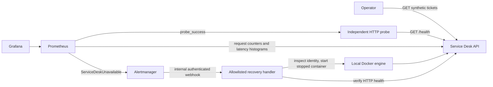

# CloudGuard — Service Desk Reliability Demo

**Advanced Cloud Computing mini project. AWS deployment: proposed only.**

CloudGuard is an original, small IT operations application and reliability experiment. An operator reads synthetic incident tickets while an independent HTTP probe checks application health. A verified outage triggers a constrained recovery handler that starts the stopped demo container and checks HTTP health. The application, configuration, handler, tests, dashboard, and measurement tools were written for this implementation. No earlier repository implementation, screenshots, logs, or measurements are used as results here.

## Industry use case

An IT Service Desk needs visibility into open incidents and a way to recover an unavailable ticket API. This demo exposes a read-only ticket queue with status, priority, and result-limit filters. Every response identifies the records as **synthetic-demo**. There are no real customers, employees, production tickets, external integrations, or write operations.

## Local setup

Requirements: Docker Desktop with Compose v2+, Python 3.9+ for operator scripts, and sufficient free disk space. Linux ARM64 is the locally tested container platform; other platforms need their own verification.

```bash
python3 scripts/bootstrap.py
docker compose config --quiet
docker compose up -d --build
docker compose ps
curl http://127.0.0.1:18000/health
curl 'http://127.0.0.1:18000/api/tickets?status=open&priority=P1&limit=20'
```

Bootstrap creates ignored local secret files and retains existing credentials on subsequent runs. Grafana's username is `cloudguard`; read `secrets/grafana_password` locally for the generated password. Never commit or paste those files into a presentation. `.env.example` contains only optional port settings. Local interfaces bind to `127.0.0.1`.

| Interface | Local URL |
|---|---|
| Service Desk API | http://127.0.0.1:18000/api/tickets?status=open&limit=20 |
| API health | http://127.0.0.1:18000/health |
| Prometheus targets | http://127.0.0.1:19090/targets |
| Prometheus alerts | http://127.0.0.1:19090/alerts |
| Alertmanager | http://127.0.0.1:19093 |
| Provisioned Grafana dashboard | http://127.0.0.1:13000/d/cloudguard-service-desk |

## Architecture and recovery flow



Prometheus scrapes every 5 seconds and evaluates alerts every 5 seconds. The independent Blackbox Exporter keeps returning `probe_success=0` while the API is stopped; its own scrape remains available. An API `/metrics` scrape alone would disappear with the workload and does not substitute for HTTP availability. `ServiceDeskUnavailable` requires a failed HTTP probe for 10 seconds. Alertmanager waits 2 seconds for a new group and forwards the firing alert over the internal control network. Missing probe telemetry raises a separate observe-only warning.

The recovery handler accepts only authenticated internal Alertmanager batches. It ignores resolved alerts and mismatched alert names, service names, container names, jobs, and probe URLs. Before acting, it checks the actual Docker container name and Compose/custom labels. It can inspect and **start only `cloudguard-servicedesk`**; the client contains no generic restart/delete API. A nonblocking process lock prevents overlapping actions. Repeated alerts for a healthy running container have no effect. A running unhealthy workload is reported as failed rather than repeatedly restarted. Successful remediation requires the expected HTTP health response.

The recovery handler has **no published host port**. Its socket mount is private to that service, and there is no public restart endpoint or TCP Docker engine listener. The socket still grants substantial engine authority if the recovery container is compromised: a read-only socket bind does not make the Docker API read-only. This is a trusted local course demonstration, not a production multi-tenant recovery control plane. Recovery uses one Gunicorn worker with four threads so the process lock covers every request. Changing to multiple workers would require an inter-process/distributed lock.

The monitoring bridge supports localhost publication. A separate internal control network contains the API, Alertmanager, and recovery service. Stopping the API does not stop the monitoring or recovery containers.

## Tests and validation

```bash
docker run --rm --network none --read-only --tmpfs /tmp \
  cloudguard-original-runtime:local python -m unittest discover -s tests -v
docker compose exec -T prometheus promtool check config /etc/prometheus/prometheus.yml
docker compose exec -T alertmanager amtool check-config /etc/alertmanager/config.yml
```

Tests cover API health and filtering, read-only behavior, normalized request metrics, authentication, allowlisting, container identity checks, idempotency, overlap prevention, failed HTTP verification, percentile definitions, and successful-probe availability calculations. See [validation details](docs/validation.md) for what actually ran locally.

## Reproduce the benchmark

```bash
python3 scripts/lab.py benchmark --duration 20 --concurrency 4
```

The workload is a closed-loop, four-worker HTTP/1.1 keep-alive client with no think time, requesting `GET /api/tickets?status=open&limit=20`. It validates the synthetic response. Reports include requested and measured duration, request count, errors, throughput, and client round-trip average/p95/p99 latency. Percentiles use nearest rank over all completed attempts, including errors/timeouts. The client runs on the host Mac; the API has a 0.75-CPU container limit. Grafana's histogram percentiles estimate in-process latency and need not equal client round-trip percentiles.

Raw request records, independent probe samples, application logs, container details, and the summary are saved in a new ignored `output/benchmark-<UTC>/` directory.

## Reproduce controlled recovery

```bash
python3 scripts/lab.py recover --trials 3
```

This command performs at most three trials, establishing healthy HTTP and monitoring baselines before each. It records UTC immediately before `docker stop cloudguard-servicedesk`, waits for automatic recovery, and correlates the independent raw probe samples with the handler's structured journal. A manual stop suppresses Docker's normal restart-policy behavior so the experiment measures the alert/recovery path. No manual start is used for a successful trial.

Each trial saves the stop marker, first failed probe, alert receipt, remediation start and finish, first successful probe, Docker events, relevant service logs, container snapshots, and raw probe/monitoring samples. It also checks that monitoring container identities and start times were retained. A timeout, missing success record, or monitoring restart is a failed trial. A manual start may restore a still-stopped workload **only as cleanup after a failed trial**, which remains failed; subsequent trials stop. The mean uses only completed successful trials, and failed attempts are listed explicitly.

| Measurement | Definition |
|---|---|
| Detection interval | Pre-stop UTC marker to first failed HTTP probe sample |
| Scrape-observed TTR | First failed probe sample to first subsequent successful probe sample |
| Remediation execution | Handler's remediation-start event to verified HTTP recovery finish |
| Observed availability | Successful independent probe samples / all observed probe samples within the stated UTC window |

Raw range-vector queries preserve the original sample timestamps. Missing telemetry is not counted as a successful probe. Sampling occurs every 5 seconds, so transitions between samples remain uncertain. The short observation-window availability is not a production SLA. The evidence packet includes a runtime/configuration source fingerprint; raw evidence is ignored by Git and must be backed up separately.

## Proposed targets and measured local results

Proposed objectives for a future deployed Service Desk are **99.9% monthly successful HTTP probes**, ticket endpoint **p95 client latency below 250 ms** under a defined light workload, and **scrape-observed TTR within 45 seconds** for this specific controlled-stop scenario. These are project targets, not established contractual guarantees or AWS results. A fixed 30-day 99.9% objective allows 2,592 seconds of downtime, but the local experiment cannot demonstrate month-long compliance.

Verified benchmark and recovery results for this implementation are documented in [presentation results](docs/presentation-results.md). AWS EC2 and CloudWatch deployment remains **proposed only**.

## Limitations

- Synthetic, in-memory, read-only tickets; no authentication, durable ticket database, or real business workload.
- Single Docker host, one allowlisted workload, one recovery process. A host, Docker daemon, or monitoring outage cannot be repaired by this design.
- Recovery starts a stopped existing container; it does not recreate deleted containers or repair a running but unhealthy process.
- Short closed-loop load test and at most three local trials are not a capacity study, statistically robust tail-latency study, or production SLA proof.
- Restarts reset application counters; Prometheus `rate()` handles counter resets but an outage still produces scrape gaps for application metrics.
- Dependency image license/notice files remain with their upstream distributions; see [third-party notices](THIRD_PARTY_NOTICES.md).
- Local runtime secrets use file-based Compose secrets, not a managed secret store. Docker-group membership and the recovery socket require trusted operator access.

## Proposed EC2 demo and cleanup

The [EC2 deployment guide](docs/ec2-proposed.md) describes Docker setup, EBS storage, restricted security groups, SSH tunnels, and the proposed CloudWatch role. No AWS resources have been created or verified.

For local cleanup, `docker compose stop` retains containers and volumes. `docker compose down` removes this stack's containers and networks while retaining named volumes. Delete volumes only after backing up evidence and obtaining explicit approval. Never use a global prune to clean this project or delete the earlier workspace's data.
